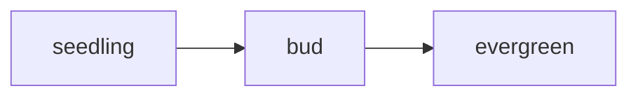
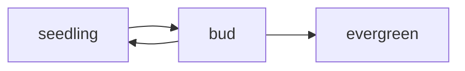

# reference page

every piece of formatting this garden supports. each section shows the syntax first, then how it looks on the site. the sample sentence throughout is: diction is done with the tip of the tongue on the teeth.

<!-- this is a hidden comment. it never shows on the site. -->

## headings

````markdown
# heading 1
## heading 2
### heading 3
#### heading 4
##### heading 5
###### heading 6
````

# heading 1: diction is done with the tip of the tongue on the teeth

## heading 2: diction is done with the tip of the tongue on the teeth

### heading 3: diction is done with the tip of the tongue on the teeth

#### heading 4: diction is done with the tip of the tongue on the teeth

##### heading 5: diction is done with the tip of the tongue on the teeth

###### heading 6: diction is done with the tip of the tongue on the teeth

a custom heading id, so you can link straight to it:

```markdown
### a heading with a custom id { #my-custom-id }
```

### a heading with a custom id { #my-custom-id }

hover over any heading to see its permalink marker.

## emphasis and inline marks

```markdown
**bold** or __bold__
*italic* or _italic_
***bold and italic***
~~strikethrough~~
^^underline^^
==highlight==
H~2~O (subscript)
x^2^ (superscript)
`inline code`
```

**diction is done with the tip of the tongue on the teeth**

*diction is done with the tip of the tongue on the teeth*

***diction is done with the tip of the tongue on the teeth***

~~diction is done with the tip of the tongue on the teeth~~

^^diction is done with the tip of the tongue on the teeth^^

==diction is done with the tip of the tongue on the teeth==

diction is done with the tip of the tongue^1^ on the teeth~2~

`diction is done with the tip of the tongue on the teeth`

a paragraph break is a blank line. a line break inside a paragraph needs a `<br>`:

diction is done with<br>the tip of the tongue<br>on the teeth

## lists

nested items need four spaces of indentation, and a list needs a blank line before it.

```markdown
- unordered item
- another item
    - nested item
        - nested again

1. ordered item
2. another item
    1. nested ordered item
```

- diction is done with the tip of the tongue on the teeth
- the tongue
    - the tip
        - the very edge of the tip
- the teeth

1. diction is done with the tip of the tongue on the teeth
2. the tongue
    1. the tip
    2. the blade
3. the teeth

### task lists

```markdown
- [x] a finished task
- [ ] an unfinished task
```

- [x] diction is done with the tip of the tongue on the teeth
- [ ] diction is done with the tip of the tongue on the teeth
- [ ] a task with a nested step
    - [x] the nested step

## links

square brackets are written with codes in the box below so the garden doesn't turn the examples into real links.

<pre><code>&#91;a link&#93;(https://en.wikipedia.org/wiki/Diction)
&lt;https://en.wikipedia.org/wiki/Diction&gt;
&#91;a link with a hover title&#93;(https://en.wikipedia.org/wiki/Diction "diction")
&#91;opens in a new tab&#93;(https://en.wikipedia.org/wiki/Diction){ target="_blank" }
&#91;another note in the garden&#93;(reference-page.md)
&#91;a heading in another note&#93;(reference-page.md#headings)
&#91;jump to a heading on this page&#93;(#headings)
&nbsp;
wikilinks, like in obsidian:
&#91;&#91;reference-page&#93;&#93;
&#91;&#91;reference-page|a custom label&#93;&#93;
&#91;&#91;reference-page#headings&#93;&#93;
&#91;&#91;reference-page#headings|a custom label&#93;&#93;</code></pre>

- [diction is done with the tip of the tongue on the teeth](https://en.wikipedia.org/wiki/Diction)
- <https://en.wikipedia.org/wiki/Dental_consonant>
- [diction is done with the tip of the tongue on the teeth](https://en.wikipedia.org/wiki/Diction "a hover title")
- [diction is done with the tip of the tongue on the teeth](https://en.wikipedia.org/wiki/Diction){ target="_blank" }
- [diction is done with the tip of the tongue on the teeth](reference-page.md)
- [diction is done with the tip of the tongue on the teeth](reference-page.md#headings)
- [diction is done with the tip of the tongue on the teeth](#headings)
- [[reference-page]]
- [[reference-page|diction is done with the tip of the tongue on the teeth]]
- [[reference-page#headings]]
- [[reference-page#headings|diction is done with the tip of the tongue on the teeth]]

external links get a small favicon in front of them automatically.

## images

<pre><code>
{ width="48" }

&nbsp;
or, like in obsidian, by file name from anywhere:
!&#91;&#91;favicon.ico&#93;&#93;
!&#91;&#91;favicon.ico|48&#93;&#93;</code></pre>

put image files in `docs/assets/`. the path is relative to the note it is written in, so a note in the top level of `docs/` uses `assets/favicon.ico`, and a note inside a folder such as `seedlings/` or `for-my-reference/` needs `../assets/favicon.ico`. the wikilink form finds the file by name, so it works from any folder.

a leaf drawn into the page itself, which always works:

{ width="48" }

your favicon, which only shows if the path matches where the file really is:

{ width="48" }

## backlinks and links to

links between notes are tracked automatically, and this note's own links are not shown to itself.

- a note that links to another note shows that note under **links to** at the top of the page
- the note being linked to lists the notes that link to it under **cited by** at the bottom, numbered like footnotes
- this works for wikilinks, normal `.md` links and embeds
- to add a link without writing one in the text, list it in the front matter with `links_to`, shown in the page metadata section below

## embedded notes

an exclamation mark in front of a wikilink pulls another note's content into this one, inside a framed block with a link back to its source. a section name after `#` embeds only that section.

<pre><code>!&#91;&#91;note name&#93;&#93;
!&#91;&#91;note name#a heading&#93;&#93;</code></pre>

this embeds the section called escaping from further down this page:

![[reference-page#escaping]]

embeds go two levels deep. relative links and footnotes inside an embedded note may not work, so keep embedded notes simple.

## blockquotes

```markdown
> a quote
>
> a second paragraph in the same quote
>
>> a quote inside a quote
```

> diction is done with the tip of the tongue on the teeth
>
> diction is done with the tip of the tongue on the teeth
>
>> diction is done with the tip of the tongue on the teeth

## callouts

obsidian-style callouts. add `-` after the type to make it collapsed, or `+` to make it foldable but open. text after the type becomes the title.

<pre><code>&gt; &#91;!note&#93;
&gt; the body of the callout
&nbsp;
&gt; &#91;!tip&#93; a custom title
&gt; the body of the callout
&nbsp;
&gt; &#91;!warning&#93;- collapsed by default
&gt; the body of the callout
&nbsp;
&gt; &#91;!question&#93;+ foldable, open by default
&gt; the body of the callout</code></pre>

> [!note]
> diction is done with the tip of the tongue on the teeth

> [!abstract]
> diction is done with the tip of the tongue on the teeth

> [!info]
> diction is done with the tip of the tongue on the teeth

> [!todo]
> diction is done with the tip of the tongue on the teeth

> [!tip]
> diction is done with the tip of the tongue on the teeth

> [!success]
> diction is done with the tip of the tongue on the teeth

> [!question]
> diction is done with the tip of the tongue on the teeth

> [!warning]
> diction is done with the tip of the tongue on the teeth

> [!failure]
> diction is done with the tip of the tongue on the teeth

> [!danger]
> diction is done with the tip of the tongue on the teeth

> [!bug]
> diction is done with the tip of the tongue on the teeth

> [!example]
> diction is done with the tip of the tongue on the teeth

> [!quote]
> diction is done with the tip of the tongue on the teeth

> [!tip] a custom title
> diction is done with the tip of the tongue on the teeth

> [!warning]- collapsed by default
> diction is done with the tip of the tongue on the teeth

> [!question]+ foldable, open by default
> diction is done with the tip of the tongue on the teeth

### native admonitions and collapsible blocks

```markdown
!!! note "a title"
    the body, indented four spaces

??? tip "collapsed by default"
    the body, indented four spaces

???+ example "open by default"
    the body, indented four spaces
```

!!! note "a native admonition"
    diction is done with the tip of the tongue on the teeth

??? tip "collapsible, closed by default"
    diction is done with the tip of the tongue on the teeth

???+ example "collapsible, open by default"
    diction is done with the tip of the tongue on the teeth

## code

````markdown
`inline code`

```python
print("a fenced block with a language")
```

```
a fenced block with no language
```
````

diction is done with the tip of the tongue on the teeth, as `inline code`.

```python
# diction is done with the tip of the tongue on the teeth
@speak_clearly
def say(sentence: str, volume: int = 3) -> str:
    """return the sentence, a little louder."""
    words = [w.upper() for w in sentence.split()]
    if volume > 2 and words:
        return " ".join(words) + "!"
    return sentence

class Tongue(Mouth):
    teeth = None

print(say("diction is done with the tip of the tongue on the teeth", 4.5))
```

```javascript
// diction is done with the tip of the tongue on the teeth
const say = async (sentence, volume = 3) => {
  const words = sentence.split(" ").map((w) => w.toUpperCase());
  if (volume > 2 && words.length) return `${words.join(" ")}!`;
  return sentence;
};
say("diction is done with the tip of the tongue on the teeth");
```

```css
.tongue:hover > .tip {
  color: #DF7386;
  margin: 0 1.5rem;
  transition: all 0.2s ease;
}
```

```html
<!-- diction is done with the tip of the tongue on the teeth -->
<a class="tongue" href="/teeth" id="tip">diction is done with the tip of the tongue on the teeth</a>
```

```yaml
# diction is done with the tip of the tongue on the teeth
sentence: diction is done with the tip of the tongue on the teeth
volume: 3
tags: [speech, diction]
enabled: true
```

```bash
# diction is done with the tip of the tongue on the teeth
echo "diction is done with the tip of the tongue on the teeth" | tr a-z A-Z
mkdocs serve
```

```json
{
  "sentence": "diction is done with the tip of the tongue on the teeth",
  "volume": 3,
  "loud": true,
  "teeth": null
}
```

```
a fenced block with no language is plain: diction is done with the tip of the tongue on the teeth
```

## tables

```markdown
| left | center | right |
| :--- | :----: | ----: |
| a    |   b    |     c |
```

| left aligned | centered | right aligned |
| :--- | :---: | ---: |
| diction is done | with the tip of the tongue | on the teeth |
| diction is done | with the tip of the tongue | on the teeth |

## footnotes

```markdown
a sentence with a footnote.[^note]

[^note]: the footnote text, which collects at the bottom of the page.
```

footnote markers and their numbers are colored in rainbow order, repeating after eight. this page uses all eight so every color shows.

diction is done with the tip of the tongue on the teeth.[^tongue] diction is done with the tip of the tongue on the teeth.[^teeth] diction is done with the tip of the tongue on the teeth.[^lips] diction is done with the tip of the tongue on the teeth.[^breath] diction is done with the tip of the tongue on the teeth.[^jaw] diction is done with the tip of the tongue on the teeth.[^palate] diction is done with the tip of the tongue on the teeth.[^throat] diction is done with the tip of the tongue on the teeth.[^voice]
[^tongue]: the tip of the tongue touches the back of the upper teeth for sounds like t and d. this text collects at the bottom of the page.

[^teeth]: diction is done with the tip of the tongue on the teeth.

[^lips]: diction is done with the tip of the tongue on the teeth.

[^breath]: diction is done with the tip of the tongue on the teeth.

[^jaw]: diction is done with the tip of the tongue on the teeth.

[^palate]: diction is done with the tip of the tongue on the teeth.

[^throat]: diction is done with the tip of the tongue on the teeth.

[^voice]: diction is done with the tip of the tongue on the teeth.
## definition lists

```markdown
term
:   its definition, with a colon and three spaces
```

tongue
:   diction is done with the tip of the tongue on the teeth

teeth
:   diction is done with the tip of the tongue on the teeth

## abbreviations

```markdown
the TTT is hoverable.

*[TTT]: tip of the tongue on the teeth
```

diction is done with the TTT. hover over the underlined letters.

*[TTT]: tip of the tongue on the teeth

## tabs

````markdown
=== "first tab"
    the content, indented four spaces

=== "second tab"
    more content
````

the tab labels use the rainbow colors in order, and there are eight so all of them show.

=== "first tab"
    diction is done with the tip of the tongue on the teeth

=== "second tab"
    diction is done with the **tip** of the *tongue* on the ==teeth==

=== "third tab"
    - diction is done
    - with the tip of the tongue
    - on the teeth

=== "fourth tab"
    diction is done with the tip of the tongue on the teeth

=== "fifth tab"
    diction is done with the tip of the tongue on the teeth

=== "sixth tab"
    diction is done with the tip of the tongue on the teeth

=== "seventh tab"
    diction is done with the tip of the tongue on the teeth

=== "eighth tab"
    diction is done with the tip of the tongue on the teeth
## attribute lists

add classes, ids and attributes to almost any element. the classes below come from this site's stylesheet. a badge takes one of the stage classes to pick its color: `stage-seedling`, `stage-bud` or `stage-evergreen`. wrap a badge or tag in a link to make it clickable.

<pre><code>a paragraph turned into a card.
{: .card }
&nbsp;
&#91;seedling&#93;(../seedlings/index.md){ .badge .stage-seedling }
&#91;bud&#93;(../buds/index.md){ .badge .stage-bud }
&#91;evergreen&#93;(../evergreens/index.md){ .badge .stage-evergreen }
&#91;#reference&#93;(../by-tag/index.md#tag-reference){ .tag }
&#91;a link&#93;(https://en.wikipedia.org/wiki/Diction){ target="_blank" }
{ width="48" }</code></pre>

diction is done with the tip of the tongue on the teeth.
{: .card }

[seedling](../seedlings/index.md){ .badge .stage-seedling } [bud](../buds/index.md){ .badge .stage-bud } [evergreen](../evergreens/index.md){ .badge .stage-evergreen } [#reference](../by-tag/index.md#tag-reference){ .tag } [#formatting](../by-tag/index.md#tag-formatting){ .tag }

## raw html

html works anywhere in markdown.

```html
<kbd>Ctrl</kbd> + <kbd>K</kbd>
<mark>highlighted</mark>
<u>underlined</u>
<small>small text</small>
H<sub>2</sub>O and x<sup>2</sup>
<abbr title="tip of the tongue on the teeth">TTT</abbr>
<!-- a hidden comment -->
<details markdown="1">
<summary>a collapsible section</summary>

the contents, which can contain **markdown**.

</details>
```

press <kbd>Ctrl</kbd> + <kbd>K</kbd> and say: diction is done with the tip of the tongue on the teeth

<mark>diction is done with the tip of the tongue on the teeth</mark>

<u>diction is done with the tip of the tongue on the teeth</u>

<small>diction is done with the tip of the tongue on the teeth</small>

diction is done with the tip of the tongue<sup>1</sup> on the teeth<sub>2</sub>

<details markdown="1">
<summary>a collapsible section: diction is done with the tip of the tongue on the teeth</summary>

diction is done with the tip of the tongue on the **teeth**.

</details>

## horizontal rules

```markdown
---
```

diction is done with the tip of the tongue on the teeth

---

diction is done with the tip of the tongue on the teeth

## layout helpers

these use `md_in_html`, so write `markdown` on each div and leave blank lines around the content.

```html
<div class="grid" markdown>

<div class="card" markdown>

**card one**

the content

</div>

<div class="card" markdown>

**card two**

the content

</div>

</div>
```

### grid of cards

<div class="grid" markdown>

<div class="card" markdown>

**card one**

diction is done with the tip of the tongue on the teeth

</div>

<div class="card" markdown>

**card two**

diction is done with the tip of the tongue on the teeth

</div>

<div class="card" markdown>

**card three**

diction is done with the tip of the tongue on the teeth

</div>

</div>

### masonry

```html
<div class="masonry" markdown>
cards of different heights go here
</div>
```

<div class="masonry" markdown>

<div class="card" markdown>

**short card**

diction is done with the tip of the tongue on the teeth

</div>

<div class="card" markdown>

**tall card**

diction is done with the tip of the tongue on the teeth. diction is done with the tip of the tongue on the teeth. diction is done with the tip of the tongue on the teeth. diction is done with the tip of the tongue on the teeth.

</div>

<div class="card" markdown>

**medium card**

diction is done with the tip of the tongue on the teeth. diction is done with the tip of the tongue on the teeth.

</div>

<div class="card" markdown>

**another short card**

diction is done with the tip of the tongue on the teeth

</div>

</div>

### text columns

```html
<div class="columns-2" markdown>
text that flows into two columns (use columns-3 for three)
</div>
```

<div class="columns-2" markdown>

diction is done with the tip of the tongue on the teeth. diction is done with the tip of the tongue on the teeth. diction is done with the tip of the tongue on the teeth. diction is done with the tip of the tongue on the teeth. diction is done with the tip of the tongue on the teeth. diction is done with the tip of the tongue on the teeth. diction is done with the tip of the tongue on the teeth. diction is done with the tip of the tongue on the teeth.

</div>

## diagrams

mermaid diagrams go in a fenced block with the language `mermaid`. they follow the light and dark theme, and the mermaid library only loads on pages that contain a diagram.

````markdown

````



## color palette

the eight accent colors side by side, in the order they are used for tabs, footnotes and the numbers under cited by. the sidebar and page accents follow the same order from top to bottom.

<div class="swatches">
<span style="background: var(--rb-0)">1 red</span>
<span style="background: var(--rb-1)">2 orange</span>
<span style="background: var(--rb-2)">3 yellow</span>
<span style="background: var(--rb-3)">4 green</span>
<span style="background: var(--rb-4)">5 turquoise</span>
<span style="background: var(--rb-5)">6 blue</span>
<span style="background: var(--rb-6)">7 indigo</span>
<span style="background: var(--rb-7)">8 purple</span>
</div>

## escaping

a backslash in front of a character shows it literally.

```markdown
\*not italic\*
\# not a heading
```

\*diction\* is done with the tip of the tongue on the teeth

## page metadata

the block at the very top of a note, between two `---` lines, is its front matter.

```yaml
---
title: a custom title (otherwise the first heading is used)
stage: seedling
tags: [idea, book]
planted: 2026-11-10
tended: 2026-11-10
links_to: [another note, a third note]
template: home.html
---
```

- `stage` shows a colored badge: `seedling`, `bud` or `evergreen`
- `tags` show as pills under the title and in the homepage tag cloud, and each pill links to its section on the by tag page
- `links_to` adds links to other notes by title or filename, even if the text doesn't link to them
- `planted` and `tended` show as dates, and `tended` sorts the "recently tended" widget
- `template: home.html` is only for your homepage, to turn on the widgets

## not supported

math written as `$math$` has no equivalent here yet.