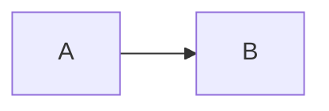

## Extensions test

!!! note "a note"
    a work.

??? tip "collapsible"
    click to open.

=== "tab one"
    first tab.

=== "tab two"
    not the first tab.

=== "tab three"
    not the first tab.

=== "tab four"
    not the first tab.

=== "tab five"
    not the first tab.

=== "tab six"
    not the first tab.

=== "tab seven"
    not the first tab.

=== "tab eight"
    not the first tab.

- [x] done task
- [ ] open task

==highlight== and H~2~O and x^2^ and ++ctrl+c++

footnote here.[^1]

[^1]: the footnote text.

```python
print("hello")
```

